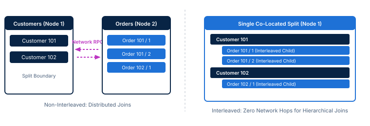

<!-- course-title: Google Spanner: Hands-On -->
<!-- course-theme: roi-alt-theme -->

<!-- layout: title -->


Google Spanner: Hands-On

# Chapter 2: Schema Design and Data Modeling

---

# Chapter 2: Objectives

- Design schemas that leverage table interleaving and prevent key hotspotting
- Select data types and schema features across GoogleSQL and PostgreSQL dialects
- Define primary keys that distribute reads and writes to avoid hotspotting
- Model parent-child relationships using interleaved tables for co-located storage
- Create secondary indexes with stored columns to accelerate read queries
- Enforce data integrity rules using generated columns and check constraints
- Implement and validate an interleaved schema in Cloud Spanner

---

<!-- layout: navigation -->
# Chapter 2

- **Data Types and Schemas in GoogleSQL and PostgreSQL Dialects**
- Primary Keys and Avoiding Hotspots
- Table Interleaving and Parent-Child Relationships
- Secondary Indexes and Stored Columns
- Generated Columns and Check Constraints
- Lab: Designing and Implementing an Interleaved Spanner Schema

---

<!-- layout: 2-column -->
# Dialect Selection: GoogleSQL vs PostgreSQL

### GoogleSQL Dialect
- Google native relational dialect aligned with GoogleSQL and BigQuery standards
- Native types include `INT64`, `FLOAT64`, `NUMERIC`, `STRING`, `BYTES`, and `JSON`
- Offers full feature parity with all Spanner capabilities and internal extensions
- Ideal for greenfield cloud applications standardizing on Google Cloud services

### PostgreSQL Dialect
- Implements a core subset of PostgreSQL syntax and data type conventions
- Maps types to familiar names: `bigint`, `double precision`, `numeric`, and `varchar`
- Integrates with standard PostgreSQL client drivers, query tools, and ORMs
- Lowers retooling overhead when migrating teams with PostgreSQL expertise

<!-- below-columns -->

> [!IMPORTANT]
> The database dialect is selected permanently at database creation time. You cannot alter or convert the dialect of an existing Spanner database.

---

# Core Data Types Across Dialects

| Logical Type | GoogleSQL Dialect | PostgreSQL Dialect | Storage and Precision Semantics |
| :--- | :--- | :--- | :--- |
| **Boolean** | `BOOL` | `boolean` | `true` or `false` |
| **Integer** | `INT64` | `bigint` | 64-bit signed integer (no 32-bit type) |
| **Floating Point** | `FLOAT64` | `double precision` | IEEE 754 64-bit binary float |
| **Exact Numeric** | `NUMERIC` | `numeric` | 38 digits precision, 9 fractional digits |
| **Text String** | `STRING(L)` | `varchar(L)` / `text` | Variable length UTF-8 encoded text |
| **Binary Data** | `BYTES(L)` | `bytea` | Variable length raw binary bytes |
| **Timestamp** | `TIMESTAMP` | `timestamptz` | Microsecond or nanosecond UTC timestamp |
| **Semi-Structured** | `JSON` | `jsonb` | Native structured JSON document storage |

---

<!-- layout: card-layout -->
# Sizing and Precision Best Practices

### Financial Math: NUMERIC
- Always store monetary values and exact calculations in `NUMERIC` or `BIGNUMERIC`.
- Never use `FLOAT64` for currency because binary floating-point representation introduces rounding drift.

### Sizing Text Columns
- `STRING(MAX)` allows up to 2.6 MB per field, and billing reflects only actual bytes stored.
- Specify realistic bounds like `STRING(100)` on indexed columns to protect memory buffer efficiency.

### Working with Arrays
- Spanner natively supports one-dimensional arrays (`ARRAY<T>`) within individual table rows.
- Multi-dimensional arrays are prohibited, and arrays cannot participate as primary key columns.

---

<!-- layout: 2-column -->
# Defining Schemas: DDL Syntax Comparison

### GoogleSQL DDL
```sql
CREATE TABLE Customers (
  CustomerId STRING(36) NOT NULL,
  FullName STRING(128) NOT NULL,
  Balance NUMERIC,
  Metadata JSON,
  CreatedAt TIMESTAMP NOT NULL
    OPTIONS (allow_commit_timestamp=true),
) PRIMARY KEY (CustomerId);
```

### PostgreSQL DDL
```sql
CREATE TABLE customers (
  customer_id varchar(36) NOT NULL,
  full_name varchar(128) NOT NULL,
  balance numeric,
  metadata jsonb,
  created_at timestamptz NOT NULL,
  PRIMARY KEY (customer_id)
);
```

<!-- below-columns -->

> [!NOTE]
> In GoogleSQL, the `PRIMARY KEY` clause is declared after the column definitions, whereas PostgreSQL supports standard ANSI constraint syntax.

---

# Non-Blocking Online Schema Evolution

- Spanner applies schema modifications (DDL) asynchronously without locking tables
  - Production read and write queries execute uninterrupted during schema migrations
  - Eliminates planned maintenance windows previously required for schema changes
- Schema transitions progress safely through internal background phases
  - **Absent**: The object does not exist in the active schema catalog
  - **Delete-Only**: Transactions writing new rows ignore the index; deletes purge old records
  - **Write-Only**: Transactions maintain new entries while Spanner backfills historical data
  - **Active**: Query planner actively utilizes the object for queries and transactions
- Adding nullable columns or dropping indexes commits as metadata-only operations in seconds

> [!TIP]
> Group multiple DDL statements into a single batch migration script to execute schema updates concurrently and minimize total backfill time.

---

<!-- layout: navigation -->
# Chapter 2

- Data Types and Schemas in GoogleSQL and PostgreSQL Dialects
- **Primary Keys and Avoiding Hotspots**
- Table Interleaving and Parent-Child Relationships
- Secondary Indexes and Stored Columns
- Generated Columns and Check Constraints
- Lab: Designing and Implementing an Interleaved Spanner Schema

---

# Primary Keys in Distributed Storage

- Primary keys serve two foundational roles in Cloud Spanner architecture
  - Relational identity: Uniquely identifies each row across the table
  - Physical row placement: Dictates the lexicographical sort order of data on disk
- Spanner partitions tables into contiguous, ordered primary key ranges called splits
  - Each split is assigned dynamically to an individual compute node and Paxos group
  - Rows with neighboring key values are co-located within the same physical split
- Primary key design directly determines whether traffic spreads across nodes or creates bottlenecks
  - Uniform key distributions balance CPU load across every node in the instance
  - Skewed key distributions concentrate traffic onto a single node, causing severe hotspots

> [!IMPORTANT]
> Unlike traditional single-node databases where sequential integers are standard practice, sequential keys in Spanner are an operational anti-pattern.

---

<!-- layout: 2-column -->
# The Sequential Key Hotspot Dilemma

### Sequential Keys (Anti-Pattern)
- Auto-incrementing integers (`1, 2, 3...`) or timestamps (`2026-11-08-10:00...`)
- Every insert writes to the maximum end of the sorted primary key range
- 100% of write traffic funnels into a single split on one compute node
- Write throughput caps at ~2,000 writes/sec regardless of instance size
- Additional compute nodes sit completely idle while one node saturates

### Distributed Keys (Best Practice)
- Keys with uniform entropy spread writes across the entire key domain
- Inserts land concurrently across dozens or hundreds of independent splits
- Write throughput scales linearly with added Processing Units or nodes
- Eliminates Paxos leader queueing and resource starvation
- Ensures resilient performance under heavy multi-threaded ingest

---

<!-- layout: card-layout -->
# Common Hotspotting Anti-Patterns

### Monotonic Sequences
- Using auto-incrementing integer IDs or sequential sequence generators.
- Routes all concurrent writes to the tail split, exhausting CPU on a single Paxos leader.

### Timestamp Prefixes
- Leading a primary key with a current timestamp or date (`YYYY-MM-DD`).
- Concentrates every incoming transaction onto the active time boundary split.

### Low-Cardinality Keys
- Using a status code, country code, or customer tier as the leading key column.
- Clumps massive row volumes into a few broad splits, creating uneven write distribution.

---

<!-- layout: 3-column -->
# Strategies for Uniform Key Distribution

### Universally Unique IDs
- Generate random UUIDv4 (`STRING(36)`)
- Distributes keys randomly across all splits
- Simple to generate across distributed client tiers
- Consumes 36 bytes of storage per row

### Bit-Reversed Integers
- Bit-reverse sequential 64-bit integer values
- Retains compact 8-byte `INT64` storage size
- Works seamlessly with sequential generators
- Native Spanner sequences provide bit-reversal

### Hash Prefixing
- Prepend a hash of natural business keys
- Example: `FARM_FINGERPRINT(NaturalKey) % 10`
- Spreads writes across N discrete key shards
- Preserves readability of domain identifiers

---

# Implementing Distributed Keys in Practice

- Cloud Spanner provides built-in mechanisms to generate hotspot-free primary keys
- Option A: Native bit-reversed sequence (GoogleSQL)
  - Produces positive 64-bit integers with uniform distribution across the entire integer range

```sql
CREATE SEQUENCE CustomerSeq OPTIONS (
  sequence_kind = 'bit_reversed_positive'
);

CREATE TABLE Customers (
  CustomerId INT64 DEFAULT (GET_NEXT_SEQUENCE_VALUE(SEQUENCE CustomerSeq)),
  CustomerName STRING(128) NOT NULL,
) PRIMARY KEY (CustomerId);
```

- Option B: Random UUIDv4 generation
  - Ideal when application microservices generate primary keys prior to insert

```sql
CREATE TABLE Orders (
  OrderId STRING(36) DEFAULT (GENERATE_UUID()),
  OrderDate TIMESTAMP NOT NULL,
) PRIMARY KEY (OrderId);
```

---

<!-- layout: navigation -->
# Chapter 2

- Data Types and Schemas in GoogleSQL and PostgreSQL Dialects
- Primary Keys and Avoiding Hotspots
- **Table Interleaving and Parent-Child Relationships**
- Secondary Indexes and Stored Columns
- Generated Columns and Check Constraints
- Lab: Designing and Implementing an Interleaved Spanner Schema

---

# What is Table Interleaving?

- A declarative relational modeling technique that physically co-locates child rows with parent rows
- Traditional distributed databases store separate tables in distinct storage partitions
  - Joining customers with orders requires network RPCs between different database servers
  - Network latency and serialization overhead increase dramatically with query complexity
- Spanner allows you to declare parent-child relationships in the schema definition
  - Child tables declare their parent via the `INTERLEAVE IN PARENT` clause
  - Child table primary keys must prefix the complete primary key of the parent table
  - Spanner physically embeds child rows immediately following the parent row in storage splits

> [!NOTE]
> Interleaving preserves standard relational semantics. Both parent and child remain independent SQL tables that support standard queries, filtering, and constraints.

---

<!-- layout: stacked -->
# Physical Storage: Interleaved vs Non-Interleaved

- Non-interleaved tables split independently across nodes, requiring network RPCs to evaluate relational joins
- Interleaved tables co-locate parent rows and all descendant rows contiguously within the same storage split
- Hierarchical joins execute locally on a single compute node with zero inter-server network hops



---

# Declaring Interleaved Hierarchies in DDL

- Interleaved hierarchies model multi-tiered relationships such as `Customers -> Orders -> OrderItems`
- Each descendant table includes the full primary key of its ancestor as the leading key columns

```sql
CREATE TABLE Customers (
  CustomerId STRING(36) NOT NULL,
  FullName STRING(128) NOT NULL,
) PRIMARY KEY (CustomerId);

CREATE TABLE Orders (
  CustomerId STRING(36) NOT NULL,
  OrderId STRING(36) NOT NULL,
  OrderDate TIMESTAMP NOT NULL,
) PRIMARY KEY (CustomerId, OrderId),
  INTERLEAVE IN PARENT Customers ON DELETE CASCADE;

CREATE TABLE OrderItems (
  CustomerId STRING(36) NOT NULL,
  OrderId STRING(36) NOT NULL,
  LineItem INT64 NOT NULL,
  Price NUMERIC NOT NULL,
) PRIMARY KEY (CustomerId, OrderId, LineItem),
  INTERLEAVE IN PARENT Orders ON DELETE CASCADE;
```

> [!IMPORTANT]
> The primary key of the child table must define the parent table’s primary key columns first, matching order and data type exactly.

---

<!-- layout: 2-column -->
# Performance Gains: Local Joins and Paxos Isolation

### Local Hierarchical Joins
- Evaluating joins on interleaved tables requires zero cross-network RPCs:
  `SELECT * FROM Customers c JOIN Orders o ON c.CustomerId = o.CustomerId WHERE c.CustomerId = '101'`
- Compute reads parent and child rows from contiguous blocks in memory and local storage.
- Delivers single-node read latency for complex relational hierarchies at global scale.

### Single Paxos Transactions
- Writing a parent row and corresponding child rows modifies data within the same split.
- Handled entirely by a single Paxos group without triggering Two-Phase Commit (2PC).
- Reduces transaction commit latency, minimizes lock contention, and maximizes write throughput.

---

<!-- layout: card-layout -->
# Interleaving Constraints and Best Practices

### Cascade Deletion Policies
- `ON DELETE CASCADE` automatically purges all descendant child rows when a parent is deleted.
- `ON DELETE NO ACTION` blocks parent deletion until all child rows are explicitly removed.

### Hierarchy Depth Limits
- Spanner supports hierarchies up to 7 levels deep (Parent down to 6th descendant tier).
- Most production architectures achieve optimal locality with 2 or 3 levels of nesting.

### Avoiding Split Bloat
- Do not interleave child tables if a single parent row hierarchy will exceed 4 GB of data.
- If an individual parent hierarchy exceeds 4 GB, Spanner cannot split it, creating a severe bottleneck.

---

<!-- layout: navigation -->
# Chapter 2

- Data Types and Schemas in GoogleSQL and PostgreSQL Dialects
- Primary Keys and Avoiding Hotspots
- Table Interleaving and Parent-Child Relationships
- **Secondary Indexes and Stored Columns**
- Generated Columns and Check Constraints
- Lab: Designing and Implementing an Interleaved Spanner Schema

---

# Secondary Indexes in Cloud Spanner

- Secondary indexes provide high-performance query access on non-primary key columns
  - In Spanner, every secondary index is physically implemented as an independent backing table
  - Index tables use the indexed columns plus the base table’s primary key as their primary key
  - Index tables are partitioned into splits and distributed across compute nodes automatically
- Synchronous and strongly consistent
  - Updates to secondary indexes commit atomically within the base table’s write transaction
  - Applications never experience replication lag or stale index entries on read queries
- Write amplification trade-off
  - Each additional secondary index requires additional Paxos logging and write consensus
  - Only index columns that serve high-volume query filters or sorting requirements

> [!NOTE]
> Because secondary indexes update synchronously, creating too many indexes on a write-intensive table directly degrades insert and update throughput.

---

<!-- layout: 2-column -->
# The Back-Join Performance Overhead

### The Index Seek Phase
- Query filters on an indexed column: `WHERE OrderDate = '2026-11-08'`
- Spanner evaluates an efficient index seek on the secondary index split.
- The index record contains only the indexed column (`OrderDate`) and base key (`CustomerId, OrderId`).
- Locates matching primary keys with high throughput and low CPU usage.

### The Distributed Back-Join Phase
- If the query requests unindexed columns (`SELECT TotalAmount, Status`), Spanner must retrieve them.
- Spanner executes a distributed join from the index split to the base table split.
- When index and base splits reside on different nodes, cross-network RPCs add latency.
- High-volume back-joins saturate network bandwidth and degrade overall query responsiveness.

---

# Eliminating Back-Joins with Stored Columns

- The `STORING` clause duplicates non-key columns directly into the secondary index table
- Enables "covering indexes" where queries are resolved entirely from index data alone
- Eliminates the distributed back-join phase and associated network round trips

```sql
-- Standard index: selecting TotalAmount triggers a cross-split back-join
CREATE INDEX idx_orders_date ON Orders (OrderDate);

-- Covering index: TotalAmount and Status stored directly inside the index table
CREATE INDEX idx_orders_date_covering
ON Orders (OrderDate)
STORING (TotalAmount, Status);

-- Query is 100% covered: zero back-joins required!
SELECT CustomerId, OrderId, OrderDate, TotalAmount, Status
FROM Orders
WHERE OrderDate >= '2026-11-01';
```

> [!TIP]
> Include frequently read columns in `STORING` when query latency is critical, accepting modest storage duplication in exchange for zero-network read execution.

---

<!-- layout: 2-column -->
# Interleaved Secondary Indexes

### Co-Located Index Data
- Secondary indexes can be interleaved within a parent table just like regular child tables.
- Interleaved index keys must begin with the parent table’s primary key columns.
- Physically co-locates index entries inside the parent split alongside parent and child rows.

### DDL Syntax and Performance
```sql
CREATE INDEX idx_orders_by_date
ON Orders (CustomerId, OrderDate)
INTERLEAVE IN Customers;
```
- Queries scoped to a specific customer evaluate against locally co-located index splits.
- Index updates commit inside the parent Paxos group without requiring multi-split 2PC coordination.

---

<!-- layout: card-layout -->
# Specialized Index Patterns

### Null-Filtered Indexes
- Exclude rows containing `NULL` in the indexed column using the `WHERE column IS NOT NULL` clause.
- Significantly shrinks index storage footprints and eliminates index write overhead for unassigned rows.

### Descending Sort Indexes
- Define sort order explicitly: `CREATE INDEX idx_events ON Events (EventTime DESC)`.
- Satisfies `ORDER BY EventTime DESC LIMIT 50` queries directly without in-memory sort operations.

### Query Hints for Indexes
- Force the query optimizer to utilize a specific index using query hints: `@{FORCE_INDEX=idx_orders_date}`.
- Useful during performance tuning when validating optimizer index selection under shifting data statistics.

---

<!-- layout: navigation -->
# Chapter 2

- Data Types and Schemas in GoogleSQL and PostgreSQL Dialects
- Primary Keys and Avoiding Hotspots
- Table Interleaving and Parent-Child Relationships
- Secondary Indexes and Stored Columns
- **Generated Columns and Check Constraints**
- Lab: Designing and Implementing an Interleaved Spanner Schema

---

<!-- layout: 2-column -->
# Generated Columns in Cloud Spanner

### Materialized Expressions
- Generated columns evaluate deterministic expressions referencing other columns in the same row.
- Cloud Spanner supports persistent generated columns using the `STORED` keyword.
- Values are computed and written to disk at row creation or modification time.
- Read queries access precomputed values instantly with zero runtime calculation overhead.

### Common Engineering Use Cases
- Extracting fields from semi-structured `JSON` columns for high-speed indexing
- Normalizing string casing for case-insensitive email or username searches: `LOWER(Email)`
- Generating deterministic hash prefixes to distribute sequential keys across splits
- Calculating mathematical totals or tax amounts across row attributes

<!-- below-columns -->

> [!NOTE]
> In GoogleSQL, generated columns must specify the `STORED` keyword. Non-stored (virtual) generated columns are not supported.

---

# Indexing Semi-Structured JSON Data

- Spanner natively stores `JSON` data, but individual JSON paths cannot be directly indexed
- Pattern: Extract the target JSON property into a generated stored column, then index that column

```sql
CREATE TABLE Users (
  UserId STRING(36) NOT NULL,
  ProfileData JSON NOT NULL,
  -- Extract email from JSON into a stored generated column
  Email STRING(256) AS (
    JSON_VALUE(ProfileData, '$.contact.email')
  ) STORED,
  -- Extract subscription status
  SubscriptionTier STRING(32) AS (
    JSON_VALUE(ProfileData, '$.billing.tier')
  ) STORED,
) PRIMARY KEY (UserId);

-- Create secondary index on the extracted column
CREATE INDEX idx_users_email ON Users (Email);
```

> [!TIP]
> The Spanner query optimizer automatically routes queries filtering on `JSON_VALUE(ProfileData, '$.contact.email')` to `idx_users_email` without query rewriting!

---

# Enforcing Integrity with Check Constraints

- Check constraints validate domain integrity rules directly at the Spanner database engine
  - Evaluated automatically on every `INSERT` and `UPDATE` mutation
  - Prevents data corruption across all client applications, scripts, and bulk loaders
  - Rejects transactions immediately if any boolean check evaluates to `false`

```sql
CREATE TABLE Products (
  ProductId STRING(36) NOT NULL,
  UnitPrice NUMERIC NOT NULL,
  DiscountRate NUMERIC NOT NULL,
  InventoryCount INT64 NOT NULL,
  -- Single-column domain constraint
  CONSTRAINT chk_unit_price CHECK (UnitPrice > 0),
  -- Multi-column relational constraint
  CONSTRAINT chk_discount CHECK (DiscountRate >= 0 AND DiscountRate <= 100),
  -- Inventory lower bound
  CONSTRAINT chk_inventory CHECK (InventoryCount >= 0)
) PRIMARY KEY (ProductId);
```

> [!CAUTION]
> Check constraint expressions must be strictly deterministic. Calling non-deterministic functions like `CURRENT_TIMESTAMP()` or referencing other tables is prohibited.

---

<!-- layout: 2-column -->
# Interleaving vs Foreign Key Constraints

### Table Interleaving
- Establishes physical storage co-location of parent and child rows in the same split.
- Child primary key must strictly start with the parent table’s complete primary key.
- Deletions execute locally via `ON DELETE CASCADE` without cross-node RPCs.
- Best for 1:N ownership relationships (e.g., Customers -> Orders -> LineItems).

### Foreign Key Constraints
- Establishes logical referential integrity across independent, unaligned tables.
- Child table primary key is completely independent of the referenced parent table.
- Inserts and deletes trigger cross-table validation checks, adding Two-Phase Commit overhead.
- Best for M:N relationships or shared reference lookups (e.g., Orders -> Products).

---

<!-- layout: navigation -->
# Chapter 2

- Data Types and Schemas in GoogleSQL and PostgreSQL Dialects
- Primary Keys and Avoiding Hotspots
- Table Interleaving and Parent-Child Relationships
- Secondary Indexes and Stored Columns
- Generated Columns and Check Constraints
- **Lab: Designing and Implementing an Interleaved Spanner Schema**

---

# Lab: Designing and Implementing an Interleaved Spanner Schema

Lab link: TODO

---

# What You Learned

- Designed schemas that leveraged table interleaving and prevented key hotspotting
- Selected data types and schema features across GoogleSQL and PostgreSQL dialects
- Defined primary keys that distributed reads and writes to avoid hotspotting
- Modeled parent-child relationships using interleaved tables for co-located storage
- Created secondary indexes with stored columns to accelerate read queries
- Enforced data integrity rules using generated columns and check constraints
- Implemented and validated an interleaved schema in Cloud Spanner

---

# Quiz 1 of 3

**Why is an auto-incrementing sequential integer considered an anti-pattern for a Spanner primary key?**

- A. Spanner supports only 32-bit integers, which quickly overflow in high-volume environments
- B. Sequential inserts write to the same split boundary, overloading a single node and creating a write hotspot
- C. Interleaved tables require string UUID keys and reject schemas with integer primary keys
- D. Secondary indexes cannot be created on tables that use monotonically increasing keys

---

# Quiz 1: Answer

**Why is an auto-incrementing sequential integer considered an anti-pattern for a Spanner primary key?**

**Correct: B.** Sequential inserts write to the same split boundary, overloading a single node and creating a write hotspot

- Spanner orders table rows lexicographically by primary key and partitions them into contiguous splits
- Sequential keys route all new rows to the end of the key range, saturating one compute node
- Write throughput becomes bottlenecked at ~2,000 writes/sec regardless of total cluster size
- Using UUIDv4, hash prefixing, or bit-reversed sequences distributes writes uniformly across all nodes

---

# Quiz 2 of 3

**What is the primary operational advantage of using the `STORING` clause on a secondary index?**

- A. It automatically enforces foreign key referential integrity between the index and base table
- B. It satisfies read queries directly from the index without requiring cross-node back-joins to the base table
- C. It compresses the secondary index to reduce total storage consumption in Colossus
- D. It allows the secondary index to be updated asynchronously without participating in write transactions

---

# Quiz 2: Answer

**What is the primary operational advantage of using the `STORING` clause on a secondary index?**

**Correct: B.** It satisfies read queries directly from the index without requiring cross-node back-joins to the base table

- Standard secondary indexes contain only the indexed columns and the base table primary key
- Queries requesting unindexed columns force Spanner to back-join the base table across the network
- `STORING` duplicates selected columns into the index table, creating a covering index
- Read queries execute against the index split alone, eliminating cross-split network RPCs

---

<!-- layout: 2-column -->
# Quiz 3 of 3: Discussion

### Prompt
A multi-tenant SaaS application is redesigning its PostgreSQL schema for Google Cloud Spanner. The current schema includes `Tenants`, `Users`, `Projects`, and `AuditLogs` (over 50 million events per day).

### Discuss
- Which tables should be interleaved, and what should their primary key hierarchies look like?
- How should `AuditLogs` be modeled to prevent write hotspots while supporting fast tenant-scoped queries?
- When should the team use foreign keys instead of table interleaving?

---

<!-- layout: 2-column -->
# Quiz 3: Discussion Points

**A multi-tenant SaaS application is redesigning its PostgreSQL schema for Google Cloud Spanner.**

### Strong Answers Mention
- Interleave `Users` and `Projects` under `Tenants` using `(TenantId, UserId)` and `(TenantId, ProjectId)`
- Do NOT interleave `AuditLogs` under `Tenants` if tenant log volume exceeds 4 GB per parent hierarchy
- Avoid monotonic timestamps as leading keys for `AuditLogs`; use `(TenantId, ShardId, Timestamp, EventId)` or UUID
- Use foreign keys for cross-tenant references or shared lookup tables (e.g., `Roles`, `Permissions`)

### Watch For
- Recommending auto-increment serial keys for tenant or user IDs
- Interleaving all tables into a single monolithic hierarchy without checking split size limits
- Suggesting unindexed JSON extraction queries instead of generated stored columns

---

# Questions and Answers

Questions?
